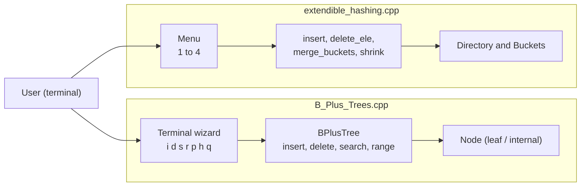
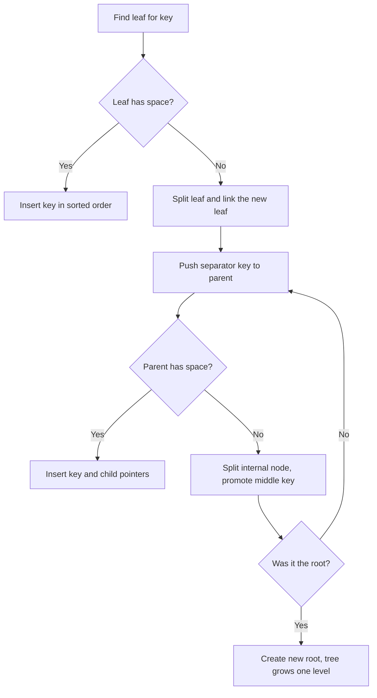
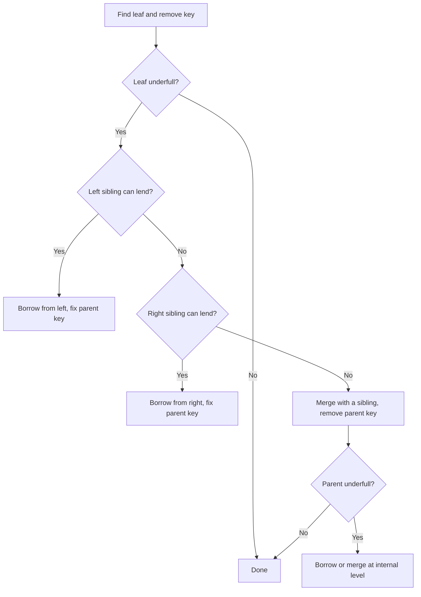
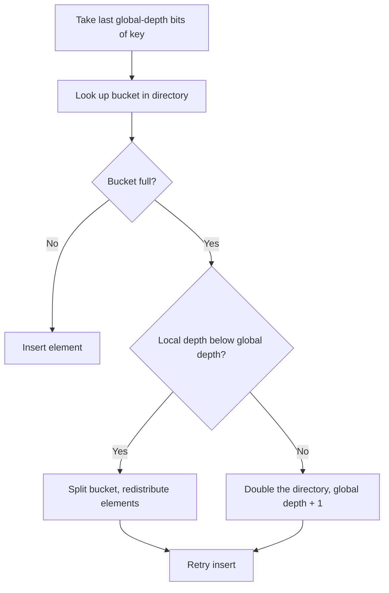
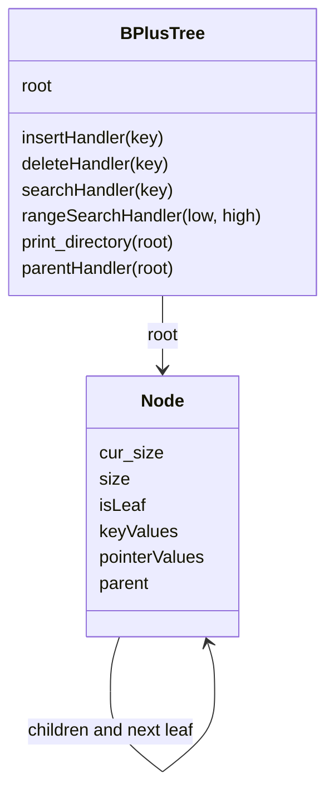
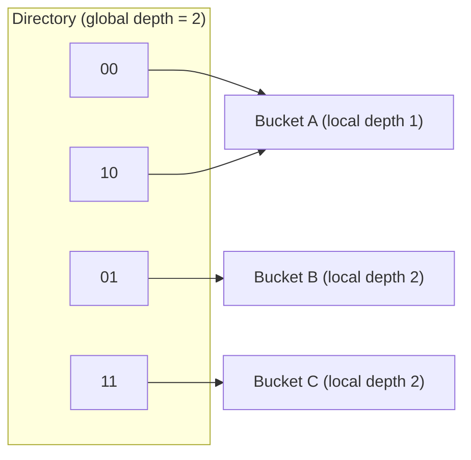

<div align="center">

# B+ Tree and Extendible Hashing

**Two classic database indexing structures implemented from scratch in C++, each with an interactive terminal interface.**

</div>

## Table of Contents
[Introduction](#introduction) · [Features](#features) · [Tech Stack](#tech-stack) · [Architecture](#architecture) · [Folder Structure](#folder-structure) · [Data Structures](#data-structures) · [Usage and Reference](#usage-and-reference) · [Installation and Setup](#installation-and-setup) · [Configuration](#configuration) · [Technical Decisions](#technical-decisions) · [License and Contribution](#license-and-contribution)

---

## Introduction
This project implements the two index structures that sit at the heart of most database engines: a **B+ Tree** for ordered data and range queries, and **Extendible Hashing** for fast equality lookups on a directory that grows and shrinks on demand.

Both are standalone, dependency-free C++ programs. You can insert, delete and search keys through a menu or command prompt and print the internal structure after every step, which makes them handy for learning how splits, merges, borrowing and directory doubling actually work.

## Features

**B+ Tree** (`B_Plus_Trees.cpp`)
- Configurable order at runtime: separate limits for internal nodes (`m`) and leaf nodes (`m_leaf`)
- Insert with leaf and internal node splitting, growing a new root when needed
- Delete with borrow-from-sibling, merge, and root collapse
- Point search and **range query** `[low, high]` through linked leaf nodes
- Duplicate keys are rejected on insert
- Level-by-level tree printing

**Extendible Hashing** (`extendible_hashing.cpp`)
- Directory with global depth and buckets with local depth
- Bucket split when a bucket overflows and its local depth is below the global depth
- Directory doubling when local depth equals global depth
- Delete with buddy bucket merge and automatic directory shrinking
- Duplicate elements are ignored on insert
- Directory printed with binary indices and bucket contents

## Tech Stack

| Area | Technology | Purpose |
|---|---|---|
| Language | C++ (C++11 or newer) | Core implementation |
| Library | STL: `vector`, `queue`, `map`, `set`, `algorithm` | Containers and sorting |
| Compiler | g++ (GCC) | Build, `<bits/stdc++.h>` support |
| Interface | Terminal (stdin / stdout) | Interactive commands |
| Dependencies | None | Single-file programs |

## Architecture



**B+ Tree insert**



**B+ Tree delete**



**Extendible Hashing insert**



## Folder Structure

```
B_plus_Tree_and_Extendible-Hashing/
├── B_Plus_Trees.cpp         # B+ Tree: Node, BPlusTree, terminal wizard, main
└── extendible_hashing.cpp   # Extendible Hashing: Bucket, directory ops, menu, main
```

| File | Main pieces |
|---|---|
| `B_Plus_Trees.cpp` | `Node` class, `BPlusTree` class (insert, delete, search, range, print), `Terminal_Wizard()`, `main()` |
| `extendible_hashing.cpp` | `Bucket` struct, `insert`, `delete_ele`, `merge_buckets`, `expandDirectory`, `shrink`, `print_directory`, `main()` |

## Data Structures

### B+ Tree



**Node**

| Field | Type | Notes |
|---|---|---|
| `cur_size` | `long long` | Number of keys currently stored |
| `size` | `long long` | Order of the node (`m` or `m_leaf`) |
| `isLeaf` | `bool` | Leaf or internal node |
| `keyValues` | `vector<long long>` | Leaf: `m_leaf` slots. Internal: `m - 1` slots |
| `pointerValues` | `vector<Node*>` | Leaf: `m_leaf + 1` slots, the last one links to the **next leaf**. Internal: `m` child pointers |
| `parent` | `Node*` | Parent node, rebuilt after every insert and delete |

**Global settings**

| Name | Meaning |
|---|---|
| `m` | Order of internal nodes: at most `m` children and `m - 1` keys |
| `m_leaf` | Maximum keys in a leaf node |

**Rules used by the code**

| Rule | Value |
|---|---|
| Leaf split | Keys are sorted with the new one, left leaf keeps `(m_leaf + 2) / 2`, the rest go to the new leaf |
| Separator key | Last key of the left leaf, **copied** up to the parent |
| Internal split | Left keeps `(m - 1) / 2` keys, the middle key is **moved** up, the rest go right |
| Child selection | A key goes to the child where `key <= separator` first holds |
| Leaf underflow | `cur_size - 1 < (m_leaf + 1) / 2` after a delete |
| Internal underflow | `cur_size < m / 2` |
| Root collapse | If the root ends up empty, its first child becomes the root |

### Extendible Hashing



Several directory entries can point to the same bucket. Bucket A is shared by `00` and `10` because both end in `0`.

**Bucket**

| Field | Type | Notes |
|---|---|---|
| `availabe_element` | `int` | Number of elements in the bucket (spelled this way in the code) |
| `local_depth` | `int` | Number of low-order bits this bucket distinguishes |
| `bucket_Set` | `set<int>` | The stored elements |

**Globals**

| Name | Type | Meaning |
|---|---|---|
| `global_depth` | `int` | Number of bits used to index the directory (starts at 0) |
| `Directory` | `map<int, Bucket*>` | Directory index → bucket |
| `mp` | `map<int, Bucket*>` | Element → bucket, for fast duplicate checks and deletes |
| `bucket_size` | macro | Bucket capacity, default `2` |

## Usage and Reference

### B+ Tree commands

| Command | Action |
|---|---|
| `i <value>` | Insert a key |
| `d <value>` | Delete a key (also prints a trace of visited and sibling nodes) |
| `s <value>` | Search for a key |
| `r <lo> <hi>` | Range query, prints every key in `[lo, hi]` |
| `p` | Print the whole tree, one level per line |
| `h` | Show the command list again |
| `q` | Quit |

At startup the program asks for `m` and `m_leaf` (for example `4 3`).

**Example session** (`m = 4`, `m_leaf = 3`, inserting 10, 20, 5, 6, 12, 30, 7, 17)

```text
Enter m , m_leaf: 4 3
Enter Command: > p

B+ tree structure...
[ 6 12 ]
[ 5 6 ]		[ 7 10 12 ]		[ 17 20 30 ]

Enter Command: > s 12
Search Result: Key Found!

Enter Command: > s 99
Search Result: Key not found!

Enter Command: > r 6 20
Range Query [6, 20]: 6 7 10 12 17 20
```

| Situation | Message |
|---|---|
| Insert succeeds | `Successfully Inserted!` |
| Key already exists | `Already present!` |
| Delete succeeds | `Successfully Deleted!` |
| Delete of a missing key | `Key not present!` |
| Delete on an empty tree | `Empty B+ Tree!` |
| Empty range result | `No keys found!` |
| Unknown command | `Command: x not found! ...` |

### B+ Tree class reference

| Method | Returns | Description |
|---|---|---|
| `insertHandler(key)` | `void` | Insert a key, splitting nodes and growing the root as needed |
| `deleteHandler(key)` | `void` | Delete a key, then borrow, merge or shrink the root |
| `searchHandler(key)` | `bool` | `true` if the key exists |
| `rangeSearchHandler(low, high)` | `vector<long long>` | Sorted keys in `[low, high]`, found by walking the leaf chain |
| `print_directory(root)` | `void` | Print the tree level by level |
| `parentHandler(root)` | `void` | Breadth-first pass that rebuilds every `parent` pointer |

### Extendible Hashing menu

| Choice | Action |
|---|---|
| `1` | Insert an element (duplicates are ignored) |
| `2` | Delete an element (missing elements are ignored) |
| `3` | Print the directory |
| `4` | Exit |

**Example session** (bucket size 2: insert 4, 5, 6, 7, print, delete 4, print)

```text
********************
0		4 6
1		5 7
********************

********************
0		6
1		5 7
********************
```

The left column is the directory index in binary (`global_depth` bits), followed by the elements of the bucket it points to.

### Extendible Hashing function reference

| Function | Description |
|---|---|
| `last_k_bits(num, k)` | Hash function: the lowest `k` bits of `num` |
| `search(ele)` | Returns the bucket holding `ele`, or `NULL` |
| `insert(ele)` | Insert with bucket split or directory doubling, then retry |
| `delete_ele(ele)` | Remove an element, then try to merge buckets |
| `merge_buckets(b)` | Merge with the buddy bucket if depths match and elements fit in one bucket |
| `expandDirectory()` | Double the directory after `global_depth` increases |
| `shrink()` | Halve the directory when every local depth is below the global depth |
| `give_binary(num)` | Format a directory index as a `global_depth`-bit binary string |
| `print_directory()` | Print every directory entry with its bucket contents |

### Complexity (as implemented)

| Operation | B+ Tree | Extendible Hashing |
|---|---|---|
| Search | `O(h · m)` | `O(log n)` through the `mp` map |
| Insert | `O(h · m log m)` | `O(2^d + log n)` plus split cost |
| Delete | `O(h · m)` | `O(2^d + log n)` plus merge cost |
| Range query | `O(h · m + k)` | Not supported |

`h` is the tree height, `m` the node order, `k` the number of keys returned, `d` the global depth and `n` the number of stored elements.

## Installation and Setup

### Prerequisites
- **g++ (GCC)** 9 or newer. `extendible_hashing.cpp` uses `<bits/stdc++.h>`, which is a GCC header
- Git
- Windows: MinGW-w64 or WSL. macOS: `brew install gcc`

### 1. Clone the repository
```bash
git clone <your-repo-url>
cd B_plus_Tree_and_Extendible-Hashing
```

### 2. Compile
```bash
g++ -std=c++17 -O2 -o bplustree B_Plus_Trees.cpp
g++ -std=c++17 -O2 -o exthash extendible_hashing.cpp
```

### 3. Run
```bash
./bplustree      # asks for m and m_leaf, then waits for commands
./exthash        # shows the numbered menu
```

| Program | Source | Build command |
|---|---|---|
| B+ Tree | `B_Plus_Trees.cpp` | `g++ -std=c++17 -O2 -o bplustree B_Plus_Trees.cpp` |
| Extendible Hashing | `extendible_hashing.cpp` | `g++ -std=c++17 -O2 -o exthash extendible_hashing.cpp` |

> **Tip:** start with small values such as `m = 4`, `m_leaf = 3` so that splits and merges happen after only a few inserts.

### Troubleshooting
- `bits/stdc++.h: No such file or directory` → use GCC (not Apple clang), or replace the include with `<iostream>`, `<map>`, `<set>`, `<vector>`, `<cmath>` and `<string>`.
- Compiler warnings about signed comparisons are harmless.
- To catch memory errors while experimenting, build with `-g -fsanitize=address,undefined`.

## Configuration
No environment variables are needed. Everything is set at runtime or compile time.

| Setting | Where | Description | Example |
|---|---|---|---|
| `m` | B+ Tree startup prompt | Order of internal nodes (max `m` children, `m - 1` keys) | `4` |
| `m_leaf` | B+ Tree startup prompt | Maximum keys per leaf node | `3` |
| `bucket_size` | `#define` in `extendible_hashing.cpp` | Maximum elements per bucket (default `2`). Rebuild after changing | `2` |

## Technical Decisions

| Decision | Why |
|---|---|
| Single-file, dependency-free programs | One `g++` command builds each one, easy to read, run and demo |
| Separate orders `m` and `m_leaf` | Internal and leaf nodes can be tuned independently, like pages with different layouts |
| Fixed-size node arrays with `cur_size` | Mimics fixed-size disk pages and keeps split and merge logic explicit |
| Leaf chain stored in the last pointer slot | Range queries walk sideways across leaves instead of climbing back to the root |
| Recursive insert that returns split info | The split key and both halves bubble up the call stack, and a new root is created only when the root itself splits |
| Separator key copied up on leaf split, moved up on internal split | Keeps every key in a leaf while internal nodes only guide the search |
| Borrow before merge on delete | Tries the left sibling, then the right, and merges only when neither can lend, which avoids needless restructuring |
| Parent pointers rebuilt by a BFS (`parentHandler`) | Avoids updating `parent` links inside every split and merge path |
| Duplicates rejected up front | A search before insert keeps keys unique |
| Hash function is the low-order bits of the key | Transparent and easy to trace by hand, ideal for learning |
| Directory as `map<int, Bucket*>` with shared bucket pointers | Several entries can point to one bucket, which models local depth directly |
| Extra `mp` (element → bucket) map | Instant duplicate check and direct bucket lookup on delete |
| Merge and shrink on delete | The directory shrinks again once every local depth is below the global depth |
| Tiny default bucket size (2) | Splits and directory doubling become visible with only a handful of inputs |
| Interactive terminal interface | Quick manual testing and visualization of the structure after each step |

## License and Contribution

### License
Licensed under the MIT License. You’re free to use, modify, and distribute this code for educational or research purposes.
